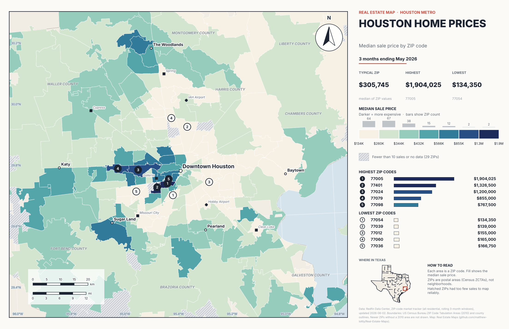
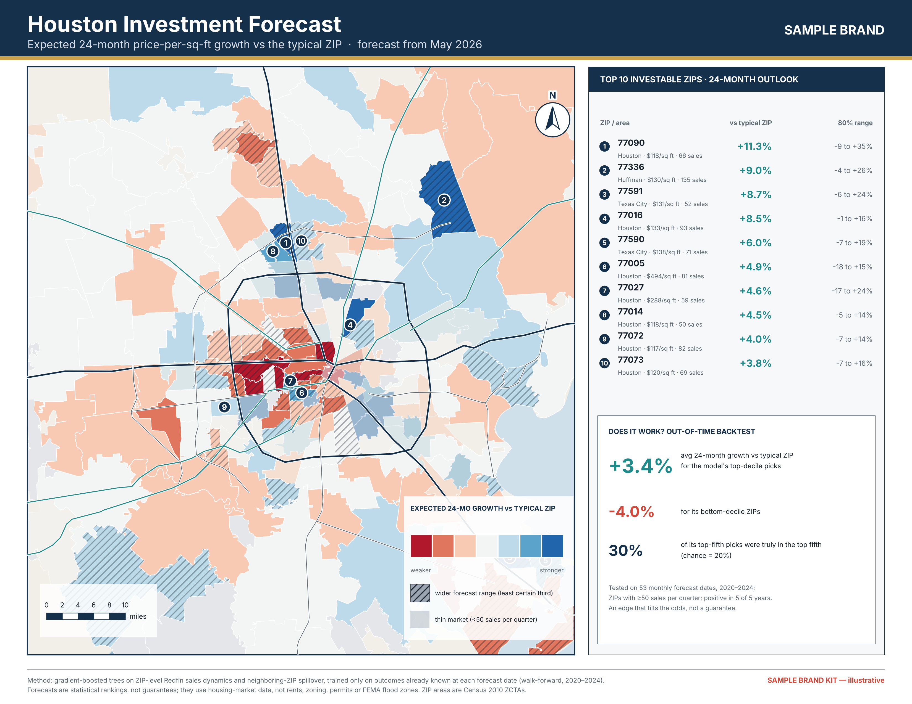

# Real Estate Maps

Cartographic real estate maps built from public data. First study area: **Houston, TX** (ZIP-code level).



More: [price per sq ft](output/houston_ppsf.png) · [year-over-year change](output/houston_yoy.png) · [days on market](output/houston_dom.png) · [sold above list](output/houston_above_list.png) · [sale-to-list](output/houston_sale_to_list.png) · [homes sold](output/houston_sales.png)

Each poster carries the usual map elements: title, stepped legend with ZIP counts per class, north arrow, km and mile scale bars, lat/lon graticule, county and place labels, a highest/lowest ranking keyed to numbered markers on the map, a Texas locator inset, a how-to-read note and a source line.

## Commercial real estate maps

Thirteen print-ready letter-landscape pages (3300x2550 px, 300 ppi PNG + PDF + layered SVG): regional access, amenities, aerial parcel, demographic rings, neighborhood market, site locator, market momentum, retail / industrial suitability, and an investor forecast set (forecast map, risk-return map, backtest evidence page). See [docs/commercial-maps.md](docs/commercial-maps.md) for what is real data and what is gated (aerial imagery, drive times, demographics, native .ai/.indd/.psd).



The forecast is a walk-forward, out-of-time tested ranking of ZIPs (see [docs/investor-forecast.md](docs/investor-forecast.md)): a modest edge that tilts the odds, not a guarantee.

## Run it

```bash
pip install -r requirements.txt
python -m real_estate_maps render --metric all      # needs PYTHONPATH=src unless installed
python -m real_estate_maps render --metric yoy --period 2025-05-31
```

Processed data is committed (`data/processed/`), so rendering needs no download. To refresh: `fetch` (streams Redfin's ~1.5 GB file and keeps Houston rows) then `build-data`.

## Design

`data.py` (download, build, load) → `metrics.py` (what to map) → `classification.py` (class breaks) → `composer.py` + `elements/` (one small class per map element). Add a metric with `MetricRegistry.register(...)`; add or reorder elements by passing your own list to `MapComposer`. Projection: EPSG:3081 (Texas Centric Albers).

## Data and caveats

- **Market data:** Redfin Data Center, ZIP-code market tracker, "All Residential", rolling 3-month windows (the ZIP file offers no single-month windows). Redfin publishes this for public use with credit; check their terms before redistributing.
- **Boundaries:** Census ZIP Code Tabulation Areas from 2010, plus county outlines at coarse resolution (so the coastline and county lines are approximate). 26 newer ZIPs have no 2010 area and are not drawn.
- ZIPs are postal areas, not neighborhoods. ZIPs with fewer than 10 sales in the window are hatched rather than coloured. Small-ZIP year-over-year changes are noisy.
- Place-label coordinates are approximate and hand-entered.
- Verified here: tests pass and the posters render. Not independently checked: Redfin figures against Redfin's own site.

## Next

Interactive explorer (metric picker and time slider), current ZCTA boundaries, other metros.
